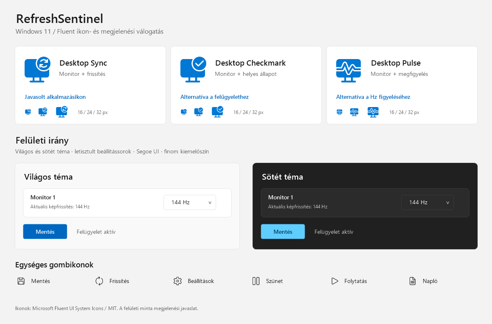

# RefreshSentinel

A small Windows 11 tray application that keeps each monitor at your preferred refresh rate.

**The interface is in Hungarian.** See the [Hungarian user guide](README.hu.md) for setup and detailed behavior.

## Download and run

1. Download **RefreshSentinel-Windows.zip** from [Releases](https://github.com/horvathbotondprivat/refreshsentinel/releases/latest).
2. Extract the archive into a permanent folder and run `RefreshSentinel.exe`.
3. Select the monitors and their target refresh rates, enable automatic checks, and save.

No installer, administrator rights, or internet connection is required. Windows 11 with .NET Framework 4.8 or 4.8.1 is required.

## Features

- Independent target refresh rates for monitors in an extended desktop.
- Configurable checks every 5–3600 seconds; default: 30 seconds.
- Restore supported refresh rates while preserving the current resolution, orientation, color depth, and desktop position in the requested mode.
- Tray menu, pause/resume, optional restoration notifications, and optional launch at sign-in.
- Persistent preferences, disconnected-monitor rules, bounded local logging, and retry cooldowns.
- No network requests, telemetry, external packages, or background service installation.

Monitoring starts **disabled** until you configure and save it. Closing the window leaves the app running in the notification area; use the tray menu to exit.

## Display behavior

RefreshSentinel uses Windows' monitor-compatible display modes and tests a requested mode before applying it. The graphics driver ultimately decides whether it can apply the request. Mode switches can briefly blank the screen.

This version tracks **integer nominal refresh rates reported by Windows**, rather than exact fractional timings or a game's frame rate. A 59.94 Hz signal may be listed as 59 or 60 Hz by the driver. VRR/G-SYNC/FreeSync instantaneous rates are outside this app's scope. For a fixed target, disable Windows Dynamic Refresh Rate in Advanced display settings. Cloned monitors cannot be managed independently; use Extend mode.

Preferences remain in `%LOCALAPPDATA%\HzGuard` and the per-user startup registry value remains `HzGuard` for compatibility with the original prototype. Exit the earlier HzGuard app from its tray menu before launching this version.

## Build and test

From a Windows PowerShell session in the repository:

```powershell
powershell -NoProfile -ExecutionPolicy Bypass -File .\build.ps1
```

The script uses Windows' .NET Framework C# compiler, runs the tests, builds `dist/RefreshSentinel.exe`, and packages `RefreshSentinel-Windows.zip`. No .NET SDK or package restore is needed.

For an environment without an interactive Windows desktop:

```powershell
powershell -NoProfile -ExecutionPolicy Bypass -File .\build.ps1 -SkipLiveChecks
```

The simulated checks cover mode filtering, identity matching, reconnects, unavailable modes, pause behavior, persistence, and retries. Live checks enumerate monitors and use `CDS_TEST` to validate their **existing** modes; they do not change refresh rates. Actual restoration is tested with simulated displays. Local diagnostics and screenshots under `verification/` are excluded from version control and distribution.

The executable is not digitally signed.

## Design assets and source

The [design directory](design/) contains the proposed Windows 11 Fluent styling, 18 original SVG assets, five ready-to-use ICO variants, a theme proposal, and the source used to generate the preview and multi-resolution icons. See the [Hungarian design guide](design/DESIGN.hu.md) and the [pinned source catalog](design/sources.json).

Regenerate the icons and preview with Windows PowerShell:

```powershell
powershell -NoProfile -ExecutionPolicy Bypass -File .\design\Build-Preview.ps1
```

Generated PNG variants are excluded from version control. The main preview and ICO files are included for convenient inspection and use. Microsoft Fluent UI System Icons are distributed with their [MIT license notice](design/LICENSE-Fluent-Icons.txt).


